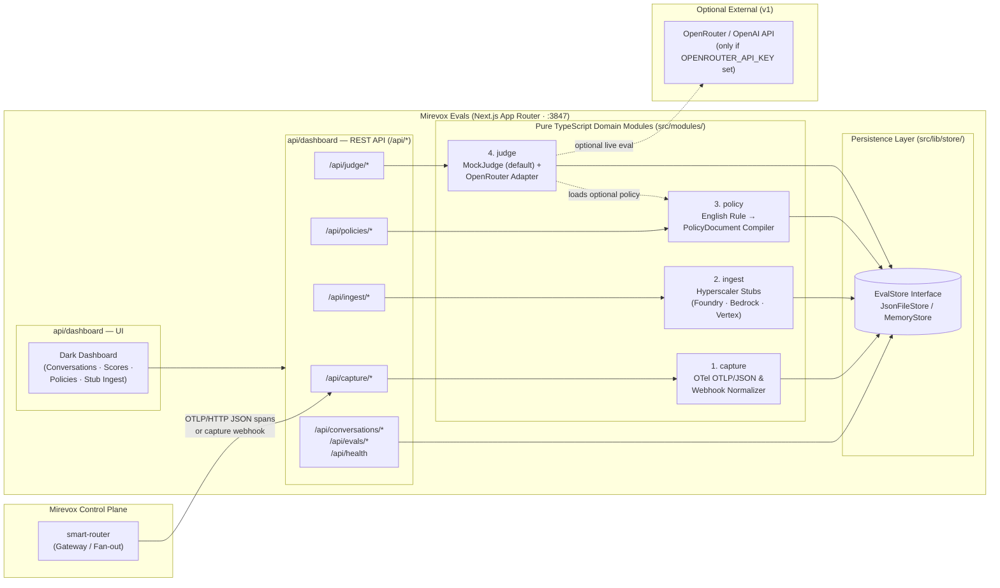

---
cursor:
  subagentId: "bc-7d636467-0961-5f7b-8b89-8740b998df3f"
  role: architect
  model: gemini-4-neon-high
---

# Mirevox Evals — v1 Architecture

Target repo: `https://github.com/Mirevox/evals`  
License: Apache-2.0  
Default port: `3847`

## 1. Architecture Narrative

Mirevox **evals** is the evaluation and English-governance module of the Mirevox agentic control plane. Because traffic flows through `smart-router`, **evals** sits alongside the router as an out-of-band observer and control-plane UI: it captures live conversation turns over HTTP/OTel, pulls hyperscaler evaluation outputs into one normalized view, compiles plain-English rules into structured policy documents, and runs an LLM-as-judge pipeline against captured turns.

For v1, the goal is a **single runnable open-source slice** with zero external infrastructure dependencies:

- **Single runtime, modular core:** One Next.js (App Router, TypeScript, Tailwind) application serves both the REST API and the dark-mode dashboard on port `3847`. All domain logic lives in four framework-agnostic TypeScript modules (`capture`, `ingest`, `policy`, `judge`) under `src/modules/` so each module can be built, unit-tested, and eventually extracted into a worker or CLI without touching Next.js internals.
- **Zero-key local execution:** Every workflow runs out of the box with no cloud accounts or API keys. Hyperscaler ingest uses fixture-backed adapters that exercise real normalization code; policy compilation runs a deterministic local parser; judging defaults to a deterministic `MockJudge` and automatically unlocks an OpenRouter/OpenAI-compatible judge when `OPENROUTER_API_KEY` is set.
- **Zero-DB persistence:** State is accessed behind an async `EvalStore` repository interface. V1 ships a JSON-file-backed store (`JsonFileStore`, atomic writes to `./data/evals-store.json`) and an in-memory store (`MemoryStore` for tests). Keeping the interface async lets v2 swap in SQLite or Postgres without changing any module or route handler.
- **Non-blocking router integration:** `smart-router` emits spans or turn webhooks fire-and-forget to **evals** (`POST /api/capture/otel` or `POST /api/capture/webhook`). If **evals** is down or slow, `smart-router` traffic continues unaffected.

---

## 2. Component Diagram



---

## 3. Module Boundaries & Repository Layout

### Directory Layout

```text
evals/
├── src/
│   ├── lib/
│   │   ├── types.ts                # Canonical domain records & API envelopes
│   │   ├── config.ts               # Env parsing (PORT, EVALS_STORE, OPENROUTER_API_KEY, etc.)
│   │   └── store/
│   │       ├── interface.ts        # Async EvalStore contract
│   │       ├── memory-store.ts     # In-memory store (tests / ephemeral mode)
│   │       ├── json-file-store.ts  # Atomic JSON file store (default v1)
│   │       └── index.ts            # Singleton accessor pinned to globalThis
│   ├── modules/
│   │   ├── capture/
│   │   │   ├── types.ts            # OTLP/HTTP JSON & webhook input types
│   │   │   ├── otel-normalizer.ts  # GenAI OTel span/event → ConversationTurn[]
│   │   │   ├── webhook-normalizer.ts # smart-router webhook → ConversationTurn
│   │   │   └── index.ts            # Public capture service API
│   │   ├── ingest/
│   │   │   ├── fixtures/           # Realistic raw payloads (foundry, bedrock, vertex)
│   │   │   ├── adapters/
│   │   │   │   ├── azure-foundry.ts
│   │   │   │   ├── aws-bedrock.ts
│   │   │   │   └── google-vertex.ts
│   │   │   └── index.ts            # Registry + deduplicated ingest runner
│   │   ├── policy/
│   │   │   ├── parser.ts           # Clause splitter, pattern/threshold extractors
│   │   │   ├── provider-preview.ts # Dry-run target mapping hints (no push)
│   │   │   └── index.ts            # compileEnglishPolicy() + validator
│   │   └── judge/
│   │       ├── interface.ts        # JudgeAdapter contract
│   │       ├── mock-judge.ts       # Deterministic heuristic + policy-aware MockJudge
│   │       ├── openrouter-judge.ts # Optional OpenRouter/OpenAI chat-completions judge
│   │       └── index.ts            # Judge runner + adapter resolution
│   └── app/
│       ├── layout.tsx              # Dark theme shell (purple + neon-blue accents)
│       ├── page.tsx                # Dashboard overview + tabs
│       ├── components/             # ConversationsPanel, ScoresPanel, PolicyPanel, IngestPanel
│       └── api/                    # Thin Next.js App Router route handlers
├── data/                           # Runtime JSON store (gitignored; Docker volume mount)
├── tests/                          # Unit + route integration tests per module
├── Dockerfile                      # Multi-stage standalone Next.js build (later/ready)
├── next.config.ts                  # output: "standalone"
└── package.json
```

### Dependency Rules

1. `src/lib/types.ts` has **zero** internal imports.
2. Each module in `src/modules/{capture,ingest,policy,judge}` imports only `src/lib/types.ts` (and its own internal files). Modules do **not** import `next/*` or read `process.env` directly—config and `EvalStore` are injected via function parameters or thin factory helpers so parallel testers can test each module in complete isolation.
3. The only permitted cross-module data flow is `judge` consuming a `PolicyDocument` record (passed by value from `EvalStore`) to evaluate rule checks alongside rubric dimensions.
4. `src/app/api/**` route handlers are thin adapters: validate input (Zod), call the module + `EvalStore`, and format HTTP responses.

### Module Responsibilities

#### 1. `capture` — OTel & Webhook Conversation Capture
- **Purpose:** Ingest live traffic emitted by `smart-router` and normalize it into canonical `ConversationTurn` records.
- **Supported inputs:**
  - **Webhook payload:** Direct JSON from `smart-router` containing `conversationId`, `traceId`, `provider`, `model`, `prompt`, `response`, `latencyMs`, token counts, and `routePolicy`.
  - **OTLP/HTTP JSON traces:** Standard `resourceSpans[].scopeSpans[].spans[]` payloads following OpenTelemetry GenAI semantic conventions (`gen_ai.system`, `gen_ai.request.model`, `gen_ai.prompt`, `gen_ai.completion`, `gen_ai.usage.input_tokens`, `gen_ai.usage.output_tokens`, plus `mirevox.route_policy` / `mirevox.conversation_id`). Extracts prompts/completions from either span attributes or span events (`gen_ai.content.prompt`, `gen_ai.content.completion`).
- **Behavior:** Deduplicates on `spanId` (when present), stamps `capturedAt`, and persists via `store.saveTurns()`. Returns `{ accepted, skipped, turnIds }`.
- **Auth hook:** Optional bearer token check (`EVALS_CAPTURE_TOKEN`); bypassed when unset for zero-friction local dev.

#### 2. `ingest` — Hyperscaler Evaluation Ingest Stubs
- **Purpose:** Pull external hyperscaler evaluation results into the unified `EvalResult` schema.
- **Providers in v1:** `azure-foundry`, `aws-bedrock`, `google-vertex`.
- **Design:** Each adapter bundles realistic provider-shaped JSON fixtures (preserving native metric names and scales, e.g., Foundry `1–5` groundedness/relevance, Bedrock `0–1` faithfulness/toxicity, Vertex `1–5` fulfillment/instruction-following) and runs them through a **real** normalizer function into canonical `0.0–1.0` `EvalResult` records with `rawScore`, `rawScale`, and `externalEvalId`.
- **Idempotency:** Persisting checks `(provider, externalEvalId)` so clicking "Trigger Stub Ingest" repeatedly does not duplicate rows; supports an optional `reset: true` flag to re-seed fixtures cleanly.

#### 3. `policy` — English Rule → Policy Compiler Stub
- **Purpose:** Translate plain-English governance/eval rules into a deterministic, machine-readable `PolicyDocument` JSON.
- **Compiler pipeline (no LLM required in v1):**
  1. Split input text into rule clauses (by line or sentence boundary).
  2. Classify each clause into a `category` (`pii`, `safety`, `groundedness`, `format`, `latency`, `cost`, `custom`) using deterministic keyword/pattern matchers.
  3. Extract severity (`info` | `warn` | `block`), metric thresholds (e.g., `>= 0.8`, `under 500 words`, `< 2000ms`), and target providers mentioned in text (defaults to `["azure-foundry", "aws-bedrock", "google-vertex", "mirevox-judge"]`).
  4. Attach dry-run `providerMappings` showing the conceptual target primitive per hyperscaler (e.g., Foundry Content Safety / Evaluator, Bedrock Guardrails, Vertex Eval Metric) with `pushStatus: "not_pushed"`.
  5. Emit `warnings` for ambiguous or unparsed clauses rather than silently dropping rules.
- **No external side effects:** Compiles and saves locally; never pushes to cloud APIs in v1.

#### 4. `judge` — LLM-as-Judge Pipeline
- **Purpose:** Evaluate any captured `ConversationTurn` (or ad-hoc prompt/response pair) against a default rubric and/or a compiled `PolicyDocument`, producing a canonical `EvalResult`.
- **Adapters:**
  - **`MockJudge` (default):** 100% deterministic, offline, zero API key. Evaluates concrete checks (empty/refusal detection, length/conciseness bounds, lexical overlap for groundedness/relevance, regex checks for PII like email/SSN/API-key patterns, and any threshold/keyword rules from an attached `PolicyDocument`) combined with a stable FNV-1a hash jitter bound so identical inputs always yield identical scores and human-readable rationales.
  - **`OpenRouterJudge` (optional):** Enabled when `OPENROUTER_API_KEY` is present in environment. Calls `${OPENROUTER_BASE_URL:-https://openrouter.ai/api/v1}/chat/completions` using `${OPENROUTER_JUDGE_MODEL:-openai/gpt-4o-mini}` with a strict JSON rubric prompt, request timeout (default 15s), and Zod validation on the returned scores.
- **Mode resolution:** Callers may pass `mode: "auto" | "mock" | "openrouter"` (default `"auto"`). `"auto"` uses `OpenRouterJudge` if `OPENROUTER_API_KEY` is non-empty, otherwise `MockJudge`. Explicitly requesting `"openrouter"` without a key returns a `400` configuration error instead of silently pretending to be live.

#### 5. `api/dashboard` — Next.js App Router API & Dark UI
- **REST API:** Clean JSON endpoints under `src/app/api/*` serving both the dashboard and external callers (`smart-router`, CLI scripts, tests).
- **Dashboard UI:** Single-page or tabbed dark workspace styled with Tailwind (obsidian/slate dark surfaces, purple `#8b5cf6` and neon-blue `#38bdf8` accents, crisp typography, no marketing copy):
  - **Header / Status bar:** Active store mode (`json-file` / `memory`), active judge mode (`MockJudge` vs `OpenRouter`), copyable capture endpoint (`http://localhost:3847/api/capture/otel`), quick "Seed Demo Turn" button for instant first-run exploration.
  - **Conversations tab:** Table of captured `ConversationTurn`s (model, provider, route policy, latency, latest score badge), slide-over/inline turn detail viewer, and "Run Judge" action (select optional `PolicyDocument` and judge mode).
  - **Scores & Ingest tab:** Unified `EvalResult` scoreboard filterable by source (`judge`, `azure-foundry`, `aws-bedrock`, `google-vertex`), metric breakdown bars, rationale viewer, and one-click "Trigger Stub Ingest" buttons per hyperscaler or all.
  - **Policy Compiler tab:** Multi-line English rule editor with preset examples, "Compile" and "Compile & Save" actions, structured `PolicyDocument` JSON inspector, compiler warnings list, and saved policies sidebar.

---

## 4. Data Model Sketch

All records live in `src/lib/types.ts` and serialize cleanly to JSON.

```ts
export type ProviderName =
  | "azure-foundry"
  | "aws-bedrock"
  | "google-vertex"
  | "local"
  | "openrouter"
  | "unknown";

export interface ConversationTurn {
  id: string;                      // UUID or deterministic capture ID
  conversationId: string;          // Groups multi-turn sessions
  traceId?: string;                // OTel trace ID from smart-router
  spanId?: string;                 // OTel span ID (used for idempotency)
  source: "otel" | "webhook" | "manual";
  provider: ProviderName;
  model: string;
  routePolicy?: string;            // e.g., "on-prem", "cloud-fallback", "task-split"
  prompt: string;
  response: string;
  systemPrompt?: string;
  contextSnippets?: string[];      // Optional RAG/context for groundedness checks
  latencyMs?: number;
  usage?: {
    inputTokens?: number;
    outputTokens?: number;
  };
  metadata: Record<string, unknown>;
  capturedAt: string;              // ISO-8601
}

export interface MetricScore {
  name: string;                    // e.g., "groundedness", "relevance", "safety", "pii"
  score: number;                   // Normalized 0.0 .. 1.0
  passed: boolean;
  threshold?: number;              // Normalized 0.0 .. 1.0
  rawScore?: number;               // Original provider value (e.g., 4.2)
  rawScale?: string;               // e.g., "1-5", "0-1", "pass/fail"
  reason?: string;
}

export interface EvalResult {
  id: string;
  source: "judge" | "hyperscaler-ingest";
  provider: ProviderName | "mirevox-judge";
  externalEvalId?: string;         // Provider run/item ID for ingest deduplication
  turnId?: string;                 // Linked ConversationTurn.id (for judge runs)
  policyId?: string;               // Linked PolicyDocument.id (if evaluated with policy)
  judgeMode?: "mock" | "openrouter";
  judgeModel?: string;             // e.g., "mock-heuristic-v1" or "openai/gpt-4o-mini"
  targetModel: string;             // Evaluated model name
  overallScore: number;            // Normalized 0.0 .. 1.0
  passed: boolean;
  metrics: MetricScore[];
  rationale: string;
  providerMetadata?: Record<string, unknown>;
  evaluatedAt: string;             // ISO-8601
}

export type PolicyCategory =
  | "pii"
  | "safety"
  | "groundedness"
  | "format"
  | "latency"
  | "cost"
  | "custom";

export interface PolicyRule {
  id: string;
  sourceText: string;
  category: PolicyCategory;
  severity: "info" | "warn" | "block";
  condition: {
    metric: string;                // e.g., "groundedness", "word_count", "pii_detected"
    operator: "gte" | "lte" | "lt" | "gt" | "eq" | "absent" | "contains";
    value: number | string | boolean;
  };
  action: "log" | "flag" | "fail_eval" | "block_route";
}

export interface PolicyDocument {
  id: string;
  name: string;
  version: number;
  sourceEnglish: string;
  rules: PolicyRule[];
  targetProviders: Array<"azure-foundry" | "aws-bedrock" | "google-vertex" | "mirevox-judge">;
  providerMappings: Record<string, {
    pushStatus: "not_pushed";
    targetPrimitive: string;
    ruleCount: number;
  }>;
  warnings: string[];
  createdAt: string;               // ISO-8601
  updatedAt: string;               // ISO-8601
}
```

### Storage Contract (`src/lib/store/interface.ts`)

```ts
export interface EvalStore {
  // Conversations
  saveTurns(turns: ConversationTurn[]): Promise<{ inserted: ConversationTurn[]; skipped: number }>;
  listTurns(filter?: { provider?: string; model?: string; limit?: number }): Promise<ConversationTurn[]>;
  getTurn(id: string): Promise<ConversationTurn | null>;

  // Eval results (judge + hyperscaler ingest)
  saveEvals(results: EvalResult[]): Promise<{ inserted: EvalResult[]; skipped: number }>;
  listEvals(filter?: { source?: EvalResult["source"]; provider?: string; turnId?: string; limit?: number }): Promise<EvalResult[]>;
  getEval(id: string): Promise<EvalResult | null>;

  // Policies
  savePolicy(policy: PolicyDocument): Promise<PolicyDocument>;
  listPolicies(): Promise<PolicyDocument[]>;
  getPolicy(id: string): Promise<PolicyDocument | null>;
  deletePolicy(id: string): Promise<boolean>;

  // Housekeeping
  stats(): Promise<{ turns: number; evals: number; policies: number }>;
  reset(): Promise<void>;
}
```

**Next.js HMR & Persistence Note:** In `src/lib/store/index.ts`, cache the initialized `EvalStore` singleton on `globalThis.__mirevoxEvalsStore` so Next.js dev mode reloads do not create diverging store handles. `JsonFileStore` serializes writes through an in-process promise queue and writes to `<file>.tmp` followed by `fs.rename` for crash-safe persistence.

---

## 5. API Surface Sketch

All endpoints live under `src/app/api/` and return JSON with standard HTTP status codes (`200`, `201`, `400`, `401`, `404`, `502`).

| Method | Route | Module | Request Body / Query | Response (`2xx`) |
| --- | --- | --- | --- | --- |
| `GET` | `/api/health` | `api/dashboard` | — | `{ status: "ok", version, port, store: "json-file"\|"memory", judge: { defaultMode, openRouterConfigured }, counts: { turns, evals, policies } }` |
| `POST` | `/api/capture/webhook` | `capture` | Single `WebhookTurnPayload` or `{ turns: WebhookTurnPayload[] }` | `201 { accepted, skipped, turnIds }` |
| `POST` | `/api/capture/otel` | `capture` | OTLP/HTTP JSON (`{ resourceSpans: [...] }`) | `201 { accepted, skipped, turnIds }` |
| `GET` | `/api/conversations` | `api/dashboard` | `?provider=&model=&limit=` | `200 { data: ConversationTurn[], total }` |
| `GET` | `/api/conversations/[id]` | `api/dashboard` | — | `200 { data: ConversationTurn, evals: EvalResult[] }` |
| `POST` | `/api/ingest/trigger` | `ingest` | `{ providers?: ("azure-foundry"\|"aws-bedrock"\|"google-vertex")[], reset?: boolean }` | `201 { providers, inserted, skipped, results: EvalResult[] }` |
| `GET` | `/api/evals` | `api/dashboard` | `?source=judge\|hyperscaler-ingest&provider=&turnId=&limit=` | `200 { data: EvalResult[], summary: { total, avgScore, passRate } }` |
| `POST` | `/api/judge/run` | `judge` | `{ turnId?: string, inlineTurn?: { prompt, response, model?, provider?, contextSnippets? }, policyId?: string, mode?: "auto"\|"mock"\|"openrouter" }` | `201 { data: EvalResult }` |
| `POST` | `/api/policies/compile` | `policy` | `{ name?: string, english: string, save?: boolean }` | `200`/`201 { data: PolicyDocument, saved: boolean }` |
| `GET` | `/api/policies` | `policy` | — | `200 { data: PolicyDocument[] }` |
| `GET` | `/api/policies/[id]` | `policy` | — | `200 { data: PolicyDocument }` |
| `DELETE` | `/api/policies/[id]` | `policy` | — | `200 { deleted: true, id }` |

### Error Envelope

All `4xx`/`5xx` responses follow one predictable shape:

```json
{
  "error": {
    "code": "INVALID_PAYLOAD",
    "message": "Human-readable summary",
    "details": []
  }
}
```

---

## 6. Composition with Mirevox `smart-router`

`evals` composes with `smart-router` over plain HTTP with two interchangeable options—no shared database or SDK coupling required:

1. **Webhook exporter (simplest for v1):** Configure `smart-router` with `EVALS_WEBHOOK_URL=http://localhost:3847/api/capture/webhook` (and optional `EVALS_CAPTURE_TOKEN`). After `smart-router` completes a routed request or fan-out subtask, it fires an asynchronous `POST` with the turn payload (`conversationId`, `traceId`, `provider`, `model`, `routePolicy`, `prompt`, `response`, `latencyMs`, `usage`).
2. **OTel OTLP/HTTP JSON exporter (standards path):** Configure `smart-router`'s OTel tracer with `OTEL_EXPORTER_OTLP_TRACES_ENDPOINT=http://localhost:3847/api/capture/otel` and `OTEL_EXPORTER_OTLP_TRACES_PROTOCOL=http/json`. Any GenAI-annotated span is normalized into a `ConversationTurn` automatically, enabling future drop-in compatibility with other Mirevox modules (`stage-gate`, `data-lineage`) or standard OTel collectors.

In both modes, delivery is best-effort and out-of-band so evaluation latency never blocks user completions in `smart-router`.

---

## 7. Docker & Runtime Notes

V1 runs natively via `npm run dev` / `npm run build && npm run start` on port `3847`, and is structured so containerization is drop-in when ready:

- **Next.js standalone output:** Set `output: "standalone"` in `next.config.ts` so a future multi-stage `Dockerfile` (Node 22 Alpine) produces a minimal image without shipping `node_modules` bloat.
- **Port & binding:** Default `PORT=3847` and `HOSTNAME=0.0.0.0` (in container) in `package.json` scripts (`next dev -p 3847`, `next start -p 3847`).
- **Environment variables:**
  - `PORT` (default `3847`)
  - `EVALS_STORE` (`json-file` default | `memory`)
  - `EVALS_DATA_DIR` (default `./data`; mount as a Docker volume `/app/data` to survive container restarts)
  - `EVALS_CAPTURE_TOKEN` (optional shared bearer token for `/api/capture/*`)
  - `OPENROUTER_API_KEY` (optional; enables `OpenRouterJudge` when set)
  - `OPENROUTER_BASE_URL` (optional; default `https://openrouter.ai/api/v1`)
  - `OPENROUTER_JUDGE_MODEL` (optional; default `openai/gpt-4o-mini`)
- **Compose readiness:** When wired alongside `smart-router` in a lightweight module `docker-compose.yml` (without starting any full homelab stack), `smart-router` targets `http://evals:3847/api/capture/webhook` or `/api/capture/otel` on a shared bridge network, and `GET /api/health` serves as the container `HEALTHCHECK`.

---

## 8. Out of Scope (v1)

To keep v1 focused, runnable, and honest, the following are explicitly deferred:

- **Live hyperscaler cloud API pulls & pushes:** No Azure AI Foundry, AWS Bedrock, or Google Vertex SDK credentials, polling daemons, or live guardrail deployment/push from compiled policies. Stub fixtures and dry-run mapping previews only.
- **External databases & time-series warehouses:** No Postgres, ClickHouse, Redis, or Kafka. Local JSON file / in-memory store behind `EvalStore` only (SQLite/Postgres swap is a clean v2 step).
- **OTLP gRPC / Protobuf binary ingest:** V1 accepts OTLP/HTTP JSON (`application/json`) and simple webhook JSON; protobuf/gRPC receiver support is deferred.
- **Synchronous inline blocking on `smart-router`:** Evals is asynchronous/post-hoc in v1; real-time inline guardrail blocking on the request path belongs to a later router-policy integration.
- **Authentication, RBAC, and multi-tenancy:** Local single-workspace operator tool (only an optional capture bearer token).
- **Background job queues / batch dataset runners:** Judge runs execute per-turn on demand via HTTP; large dataset batch orchestration, scheduled regression suites, and WebSocket live-tailing are deferred.
- **Homelab / marketing integrations:** No full Sherali homelab stack orchestration, no n8n workflows, no Instagram/content pipelines.
